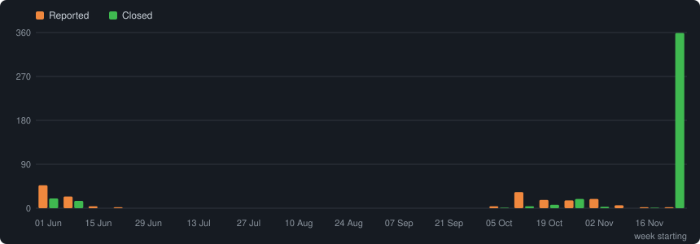

# Cinder-IssueTracker
The official issue tracker for CinderRPG

<!-- tracker-stats:start -->

## Bug report tracker

| Total reports | Active | Closed | Reported (7 days) | Closed (7 days) |
|:---:|:---:|:---:|:---:|:---:|
| **691** | **158** | **533** | 2 | 249 |

### By outcome

| Outcome | Reports |
|:---|---:|
| Patched | 235 |
| Solved | 287 |
| Invalid | 0 |
| Duplicate Report | 14 |
| Cannot Replicate | 7 |

### By tag

| Tag | All time | Still active |
|:---|---:|---:|
| Bug | 0 | 0 |
| Crash | 15 | 1 |
| Exploit | 21 | 5 |
| Dupe Bug | 17 | 2 |
| TPS | 1 | 0 |
| FPS | 2 | 0 |
| NPC Bug | 56 | 9 |
| Urgent | 16 | 2 |
| Investigating | 23 | 7 |
| Needs Info | 0 | 0 |
| Stale | 120 | 120 |

### Reports and fixes per week

Busiest week: **2025-01-06** (84 reports)

Updated automatically, last on 2026-11-23 04:49 UTC. Reports are filed through the Discord bug report forum.

<!-- tracker-stats:end -->
